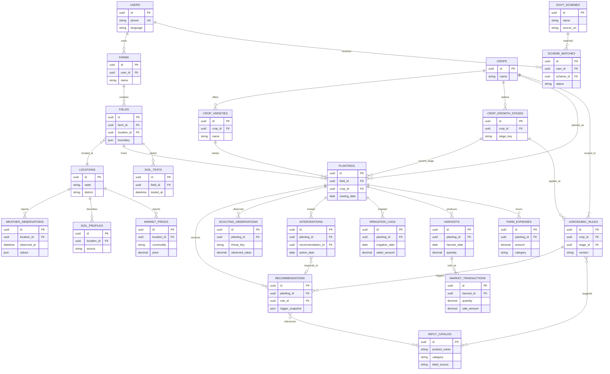

# Project Methodology and System Design

## Document purpose and implementation status

This document records the product and engineering methodology for Chiguru Nele. It combines the intended requirements and design with an implementation-status distinction so that planned offline synchronization and closed-loop learning are not mistaken for current behavior.

The repository is an academic development/demo system. The mobile app, Express/MySQL backend, rule engine, catalog, batch jobs, and ML sidecar have working implementation. The offline tunnel/reconnection flow, the complete 23-table conceptual schema below, and recommendation-to-action learning loop are **target design / acceptance criteria** unless a section explicitly says otherwise. In particular, the current app is online-only, the current SQL schema has fewer than 23 domain tables, and interventions are not yet linked to recommendations for learning.

## 1. Methodology

The project follows a farmer-centered, iterative process:

1. Understand field conditions, connectivity constraints, language needs, and routine farm-record tasks.
2. Convert those findings into testable requirements, measurable KPIs, explicit business rules, and user stories.
3. Design the domain model and primary workflows before implementing screens and services.
4. Deliver vertical slices through a continuous-flow board, with design and data preparation kept one step ahead of coding.
5. Test individual features, cross-layer flows, offline/reconnection behavior, and finally usability in a real field setting.
6. Use farmer-recorded outcomes as evidence to review and improve future advice. Any change to agronomic rules or model behavior remains subject to review and traceability.

### 1.1 Requirement gathering

#### Problem statement

Small and marginal farmers may need to make crop and input decisions using fragmented information: changing weather, local soil conditions, crop growth stage, pest observations, input availability and cost, and government programs. Connectivity and digital literacy can make general-purpose, typing-heavy software impractical in the field. Chiguru Nele aims to bring farm records and timely, understandable decision support into one mobile workflow, while preserving uncertainty and directing farmers to local experts when advice is not verified.

#### Goals and scope

**In scope**

- Farmer profile, farm/field and planting records.
- Soil-test, scouting, intervention, irrigation, harvest, and farm-economics records.
- Weather and soil context, crop threats, and a transparent rule-based prescriptive engine.
- Product suggestions restricted to the maintained Input Catalog.
- Scheme and market information with clear source, date, and uncertainty labels.
- Multilingual, low-typing mobile workflows with resilient handling of intermittent connectivity.
- Feedback capture that relates recommended actions to logged farmer actions and outcomes.

**Out of scope for the current academic release**

- Replacing agronomists, local extension officers, laboratory soil testing, or official scheme eligibility checks.
- Automated pesticide prescribing without locally approved crop, label, dose, and safety validation.
- Guaranteed yield, price, or income predictions.
- Assuming model output or historical correlation is proof that an intervention caused an outcome.
- Public production deployment with the current mock login and development security configuration.

#### KPIs and proposed targets

These are product acceptance targets to measure in pilot testing; they are not claims of current measured performance.

| KPI | Proposed target | Measurement |
|---|---:|---|
| Core task completion | At least 90% of pilot participants complete field setup, planting entry, and a farm-action log without facilitator intervention. | Moderated usability sessions; completed tasks / attempted tasks. |
| Time to log a common action | Median under 60 seconds after the field and crop are selected. | Instrumented or observed task timing. |
| Data-entry burden | At least 80% of common log fields selectable or prefilled; free-text fields optional except where essential. | Form audit and task observation. |
| Recommendation traceability | 100% of generated advice records the rule/version, triggering inputs, source timestamp, and confidence/caveat. | Automated audit of generated recommendation records. |
| Catalog safety | 100% of product recommendations resolve to an active Input Catalog item and display relevant label/safety context. | Integration checks and catalog-reference audit. |
| Offline preservation | 100% of valid entries made during a simulated network interruption remain queued locally and synchronize once connectivity returns, without silent loss or duplicate creation. | Tunnel and reconnection test cases. |
| Localization coverage | All critical task strings present in all supported locales; no untranslated key in the release locale audit. | Locale-key parity and native-speaker review. |
| Accessibility/touch usability | Primary touch targets are at least 48 dp; primary flows are operable with large text and clear status feedback. | UI audit and device testing. |
| Pilot usefulness | At least 70% of pilot farmers rate key advice as understandable and relevant, with no unsafe advice accepted as verified. | Structured post-task survey and incident review. |

Pilot sample size, geography, baseline, and duration must be recorded before using these KPIs for evaluation. Targets should be revised from measured evidence rather than reported as achieved prematurely.

#### Five functional requirement groups

1. **Identity, profile, and farm assets**: create a farmer profile; maintain farms, fields, boundaries, location, language, and land units; enforce ownership and access rules.
2. **Crop lifecycle and agronomic records**: manage crops, varieties, growth stages, plantings, soil tests, scouting observations, irrigation, interventions, and harvests.
3. **Context and reference information**: retrieve weather, soil and crop references, market observations, scheme details, and approved input catalog entries with source and freshness metadata.
4. **Decision support and feedback**: match crop/stage/weather/soil/threat conditions to rules; create explainable advice; record acknowledgement and related actions/outcomes; use reviewed feedback to improve future rule configuration.
5. **Farm economics and communication**: record input costs, labor and sales; summarize crop economics; present alerts, schemes, weather, and advice in localized, accessible screens.

#### Non-functional requirements

- **Usability:** minimize typing, use predictable navigation, actionable labels, readable cards, clear empty/error/loading states, and confirmation for consequential actions.
- **Field usability:** high contrast in sunlight, large touch targets (minimum 48 dp), limited dependence on color alone, and short task flows.
- **Connectivity resilience:** preserve drafts locally, make queued writes idempotent, expose sync state and conflicts, and never silently discard user-entered data.
- **Performance:** common screens should remain responsive on supported low/mid-range phones; image upload and sync work should not block unrelated navigation.
- **Security and privacy:** authenticate users, enforce row ownership, minimize collected data, protect secrets and transport, define retention/deletion, and obtain meaningful consent for any secondary use.
- **Reliability and integrity:** validate inputs at client and server, use database constraints/transactions, maintain auditability, and recover safely from retries.
- **Explainability and safety:** show why a rule fired, the input snapshot and freshness, uncertainty, applicability limits, and human referral where needed. Never imply unverified advice is certified.
- **Localization:** support the configured languages, locale-aware dates/numbers/units, and review translations with speakers.
- **Maintainability:** keep feature boundaries clear, version schema and rules, document data provenance, and automate repeatable checks.

#### User stories

- As a farmer, I want to create a field with a map boundary and land area so that records and local weather are associated with the correct plot.
- As a farmer, I want to add a crop and sowing date using selection controls so that the app can identify the growth stage without requiring lengthy text entry.
- As a farmer, I want to record soil-test results and see their units so that later advice can use the values correctly.
- As a farmer, I want to log a pest observation quickly, including a count or photo when useful, so that threat advice reflects what I saw.
- As a farmer, I want to see what conditions triggered an alert and when its data was collected so that I can judge whether it applies.
- As a farmer, I want recommended products to come from a known input catalog and show safety details so that I can identify the specific item being discussed.
- As a farmer, I want to record whether I followed a recommendation and what happened so that future advice can be reviewed against field experience.
- As a farmer in a weak-signal area, I want my entry to survive a connection interruption and sync later so that I do not have to re-enter it.
- As an operator, I want provenance and rule-version records so that I can correct outdated or unsuitable advice and audit its effect.

#### Business rules

1. A farmer can access and modify only records belonging to that farmer's account and assets.
2. A recommendation must be applicable to the crop and growth stage and must identify its triggering weather, soil, or scouting facts and their dates.
3. Missing, stale, or out-of-range inputs cannot be treated as a positive threat match; the system must report insufficient data or suppress the rule.
4. Product recommendations must resolve to active Input Catalog entries; never invent product names. Any dosage or safety instruction requires an approved source and applicable crop/use context.
5. Rules with no domain-expert approval are visibly marked unverified; software output cannot promote itself to verified.
6. Scheme matching is indicative and never asserts eligibility or approval.
7. Market and yield values show geography, time coverage, units or comparison method, and uncertainty; no guarantee is implied.
8. A repeated batch run must not create duplicate active recommendations for the same planting/rule/event. New advice after a previous one must retain its own version and trigger snapshot.
9. A farmer action is evidence of an action, not proof of efficacy. Feedback may inform review and prioritization, but must not silently rewrite agronomic thresholds or train a model without an approved, consent-aware process.
10. Offline writes must carry stable client-generated identifiers and reconcile idempotently; conflicts are surfaced for resolution rather than overwritten silently.

### 1.2 System and database design

The system is divided into six conceptual data layers. The following ER diagram defines **23 target domain tables** (3 + 4 + 4 + 5 + 4 + 3). It is a proposed product model, not a literal count of tables in today's migrations. The current MySQL schema is documented in [documentation/DATABASE.md](documentation/DATABASE.md); align and migrate incrementally before treating every target table as implemented.



#### The six layers

| Layer | Tables | Responsibility |
|---|---|---|
| 1. Users and assets | `users`, `farms`, `fields` | Identity, ownership, farm grouping, location, and field geometry. |
| 2. Crops and plantings | `crops`, `crop_varieties`, `crop_growth_stages`, `plantings` | Crop vocabulary, lifecycle stages, and active crop cycles on fields. |
| 3. External datasets | `locations`, `weather_observations`, `soil_profiles`, `market_prices` | Geographically and temporally sourced context, with provenance and freshness. |
| 4. Prescriptive engine | `govt_schemes`, `scheme_matches`, `agronomic_rules`, `recommendations`, `input_catalog` | Rule definitions, generated guidance, scheme candidates, and controlled product references. |
| 5. Agronomic operations | `soil_tests`, `scouting_observations`, `interventions`, `irrigation_logs` | Measured field conditions and farmer-recorded actions. |
| 6. Farm economics | `harvests`, `farm_expenses`, `market_transactions` | Production, costs, and realized sales to support farm-level summaries. |

The target model should retain source, observation time, units, and quality/freshness metadata for external observations. Rules and recommendations need version IDs and immutable trigger snapshots so historical advice can be explained after a rule changes. The `INTERVENTIONS.recommendation_id` relationship is the proposed link for measuring whether an action followed a particular recommendation; it does not assert causal benefit.

### 1.3 UI/UX design

#### Design principles

- **Zero-typing policy for routine tasks:** default to pickers, presets, location selection, date controls, recent choices, numeric steppers, and optional voice/photo capture. Free text remains available for notes and edge cases; zero typing is a design target, not a claim that every task can avoid text.
- **Bottom-tab navigation:** use a persistent tab bar for the highest-frequency destinations. The current app has Home, Fields, a central quick-log action, Schemes, and Profile; task-specific screens open as routes or modals.
- **Large controls:** primary buttons and frequently used touch targets are at least 48 dp. The current theme defines `minTouchTarget = 48`; individual controls should continue to be checked against it.
- **Outdoor-friendly color and contrast:** use the existing deep/medium green primary, neutral light surfaces, dark readable text, and distinct semantic alert colors. Pair color with labels/icons; never encode status by color alone. Test in sunlight and with large system text.
- **Plain-language, localized output:** one action per screen where feasible, clear units, short sentences, and visible confidence/caveat text adjacent to advice.
- **Resilient status feedback:** show saved locally, pending sync, synced, or needs attention; never leave a farmer guessing whether an action was stored.

#### Navigation and screen inventory

The existing app route inventory includes authentication, onboarding, tabs, field/planting modals, alerts, schemes, market, ledger, photo checks, and profile. Representative screens mapped into the planned workflows are:

| Screen | Route / current implementation | Workflows |
|---|---|---|
| Sign in and OTP | `app/(auth)/login.tsx`, `otp.tsx` | WF-01 |
| Farmer onboarding | `app/(onboarding)/step-1.tsx` through `step-5.tsx` | WF-01 |
| Home dashboard | `app/(tabs)/home.tsx` | WF-02, WF-06 |
| Field list and map | `app/(tabs)/fields.tsx`, `components/FieldBoundaryMap.tsx` | WF-02, WF-03 |
| Add/edit field | `app/modals/add-field.tsx` | WF-02 |
| Add planting | `app/modals/add-planting.tsx` | WF-03 |
| Soil test entry | `app/modals/add-soil-test.tsx` | WF-04 |
| Log scouting | `app/modals/log-scouting.tsx` | WF-04, WF-05 |
| Quick log / intervention | `app/modals/quick-log.tsx` | WF-05, WF-07 |
| Alert list/detail | `app/(tabs)/home.tsx`, `app/alert/[id].tsx` | WF-06 |
| Scheme list/detail | `app/(tabs)/schemes.tsx`, `app/scheme/[id].tsx` | WF-06 |
| Planting photo check/history | `app/planting/[plantingId]/photo-check.tsx`, `app/photo-history.tsx` | WF-04, WF-06 |
| Ledger and market view | `app/ledger/[plantingId].tsx`, `app/market.tsx` | WF-07 |
| Profile/settings | `app/(tabs)/profile.tsx` | WF-01 |

### 1.4 Workflow and wireframing

Wireframes should be made for the primary screen sequence in each workflow, including empty, loading, error, offline, and success states. The following seven workflows define the target end-to-end journeys:

| ID | Workflow | Main steps | Key screens |
|---|---|---|---|
| **WF-01** | Onboard and establish identity | Sign in → choose language → profile/farm details → unique farmer ID → complete onboarding. | Sign in, OTP, onboarding steps 1–5, profile. |
| **WF-02** | Create a farm and field | Select/create farm → choose location → enter field name/area → draw or confirm boundary → save and view field. | Home, field list/map, add field, field detail. |
| **WF-03** | Start a crop cycle | Select field → choose crop and optional variety → enter sowing date → confirm planting. | Field detail, add planting, planting detail. |
| **WF-04** | Capture soil and crop evidence | Open field/planting → enter a soil-test card or capture a scouting/photo observation → review units and date → save. | Soil test, scouting, photo check/history. |
| **WF-05** | Record a farm action | Open quick log → choose field/planting and activity → choose catalog product if relevant → add quantity/cost/date → save. | Quick log, intervention form, ledger. |
| **WF-06** | Review and respond to advice | Open alert → inspect trigger and caveat → review relevant catalog item or scheme → acknowledge, follow, or dismiss; optionally log action. | Home, alert detail, scheme list/detail, photo/disease views. |
| **WF-07** | Review farm economics and outcome | Review intervention costs → record harvest and sale → inspect crop-level cost/revenue summary → relate result to prior advice. | Ledger, harvest/sales forms (target), market view, planting detail. |

Wireframes should define entry points, back behavior, minimum tap targets, field validation, and network interruption handling. Use this workflow list as a traceability key in design reviews and QA cases.

### 1.5 Development method (planned)

Work moves continuously through a Kanban-style flow:

```text
Backlog → In Progress → Ready for QA → Done
```

- **Backlog:** ticket has an outcome, acceptance criteria, affected workflow, and dependencies.
- **In Progress:** implementation and design artifacts are updated together; schema/API changes are reviewed alongside the user flow.
- **Ready for QA:** implementation is complete, reviewable, and has the required test notes/data fixtures; QA checks acceptance criteria and regression areas.
- **Done:** acceptance criteria pass, relevant docs and translations are updated, and the change is integrated.

Organize delivery across five phases:

| Phase | Focus | Exit evidence |
|---|---|---|
| 1. Discovery and requirements | Farmer problem, scope, KPIs, stories, business rules, risk and data inventory. | Agreed requirements baseline and workflow map. |
| 2. System/data and UX design | Architecture, 23-table target ER model, wireframes, navigation, accessibility and data contracts. | Reviewed schema/API design and wireframes for the seven workflows. |
| 3. Core platform and records | Identity, farm/field, planting, soil/scouting/action records, catalog, storage and localization. | Core journeys work end to end with validation and ownership controls. |
| 4. Prescriptive support and economics | Weather/context integration, rules, catalog-linked recommendations, scheme data, feedback and farm economics. | Traceable advice, action linkage, and economics summaries meet acceptance criteria. |
| 5. Quality, field validation and release readiness | Functional/regression, offline/reconnection, localization, safety, security, and dead-zone field testing. | Test evidence, resolved critical issues, privacy review, and documented pilot limits. |

**One-step-ahead planning rule:** design and data tasks stay at least one workflow slice ahead of coding. Before a developer starts a slice, its wireframe, field definitions, source/provenance requirements, business rules, and acceptance criteria are ready. This reduces rework and prevents UI implementation from inventing data semantics. This is the planned delivery method; it should not be read as a claim that the five phases are complete.

### 1.6 Prescriptive engine and closed feedback loop

#### Advice generation

The target engine evaluates a crop cycle using its crop and growth stage, current/recent weather, available soil-test or soil-profile conditions, and relevant recent scouting observations. A rule matches only when its required inputs are present and fresh enough. Each match creates a recommendation with:

- the rule ID and version;
- planting and growth-stage context;
- observed values, threshold/operator, source, and timestamps;
- severity and confidence/review status;
- a plain-language explanation of why the rule matched;
- zero or more references to **active Input Catalog** items, including applicable crop/use and label/safety context;
- an explicit caveat and next step.

The current code already has a rule-based batch engine that matches active crop rules to the planting's growth stage and weather/recent scouting inputs, snapshots trigger values, prefixes unverified guidance, and avoids stacking a duplicate pending recommendation. Product references are stored in the catalog, but the full recommendation/action feedback cycle below remains a target design.

#### Closed-loop feedback

1. Farmer reviews advice and records an action, including whether it was followed, modified, or not followed.
2. The action is linked to the originating recommendation (planned `interventions.recommendation_id`) and records date, input/catalog item, quantity, and reason where available.
3. At a later date, the farmer may record observations or harvest/outcome data for that planting.
4. The system associates the action and later observations with the original rule/version and context snapshot.
5. A review process summarizes outcomes by context and surfaces evidence to agronomy maintainers.
6. An authorized reviewer updates rule thresholds, applicability, or wording; a new version is published with provenance and evaluation notes.
7. Future batch runs use the reviewed version, while old recommendations retain their original snapshots for audit.

This loop refines future advice through evidence-informed rule maintenance; it should not autonomously infer causation or silently change prescriptions based on one farmer's outcome. Consent, privacy, data quality, seasonality, confounders, and expert review are prerequisites for any learning or rule-update process.

### 1.7 Testing and field validation

Testing proceeds from isolated form/service checks to integration, synchronization, and field usability. The existing repository has backend unit/smoke tests, mobile Jest suites, and ML sidecar tests; the following offline acceptance cases are additional target coverage because current behavior is online-only.

#### Tunnel test (offline mid-entry)

1. Begin a valid field, soil, scouting, or intervention entry while connected.
2. Disable network access before submitting or during the save operation.
3. Confirm that the app clearly reports the connection state and preserves the full draft and attached local metadata.
4. Close/reopen or navigate away and back; verify the draft is still available if persistence is an acceptance requirement.
5. Confirm no success state is shown until the write is durably queued or server-confirmed.
6. Verify edits and retries do not create duplicate local operations.

**Pass condition:** zero silent data loss, no false synced indicator, and the user can inspect/retry the preserved entry.

#### Reconnection test (cloud sync)

1. With queued entries present, restore connectivity.
2. Verify the queue drains and each server record appears once with its original client identity and timestamps.
3. Confirm the UI transitions from pending to synced and refreshes dependent screens.
4. Retry requests and simulate a server response loss to check idempotency.
5. Create a server/local edit conflict and verify it is surfaced or resolved by a documented rule without silent overwrite.
6. Verify authorization and ownership are still enforced for every synchronized record.

**Pass condition:** all eligible records sync exactly once, conflicts are visible/handled, and local/server state converges without data loss.

#### Final dead-zone field test

Run a supervised pilot in a real low-connectivity agricultural setting using supported phones. Prepare representative workflows and test accounts; capture device/network conditions, task completion, sync queue behavior, battery and performance observations, readability outdoors, translation comprehension, and any safety/usability incident. Enter records in a known dead zone, move to connectivity, and reconcile them against server records. Repeat with interruptions at different workflow points. Obtain participant consent, avoid real sensitive data where possible, and define stop conditions for data loss or unsafe advice.

**Release gate:** do not claim offline readiness until tunnel, reconnection, and field-test evidence passes on supported devices. Document residual limitations and retest after changes to local persistence, API payloads, migrations, or synchronization logic.

## 2. Relationship to the current repository

This methodology is a target product/design document. Check current implementation before treating a target element as delivered:

- Current architecture and endpoint/data flow: [documentation/ARCHITECTURE.md](documentation/ARCHITECTURE.md).
- Current database tables and migrations: [documentation/DATABASE.md](documentation/DATABASE.md), `backend/migrations/`.
- Current UI routes and state behavior: [frontend/sustainable-farming/README.md](frontend/sustainable-farming/README.md), `frontend/sustainable-farming/app/`, `store/appStore.ts`.
- Current rule engine and batch: `backend/src/services/ruleEngine.js`, `backend/src/services/recommendationRun.js`, `backend/scripts/run-batch.js`.
- Current operational setup: [backend/README-ops.md](backend/README-ops.md).
- Safety, model, and data constraints: [DISCLAIMER.md](DISCLAIMER.md), [PRIVACY.md](PRIVACY.md), [DATASETS_STATUS.md](DATASETS_STATUS.md), and [documentation/MODEL_CARDS.md](documentation/MODEL_CARDS.md).

