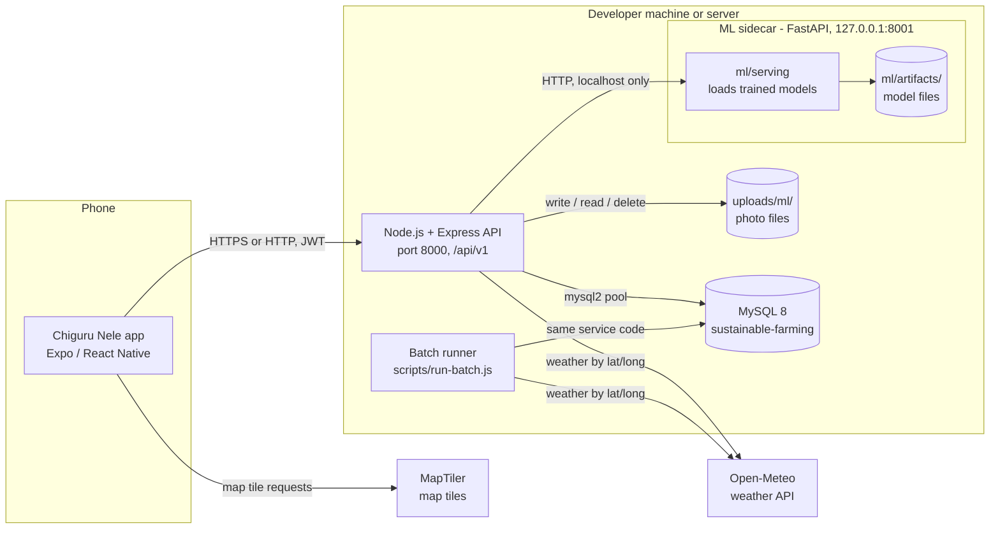
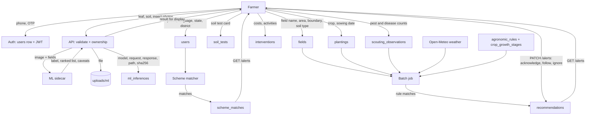
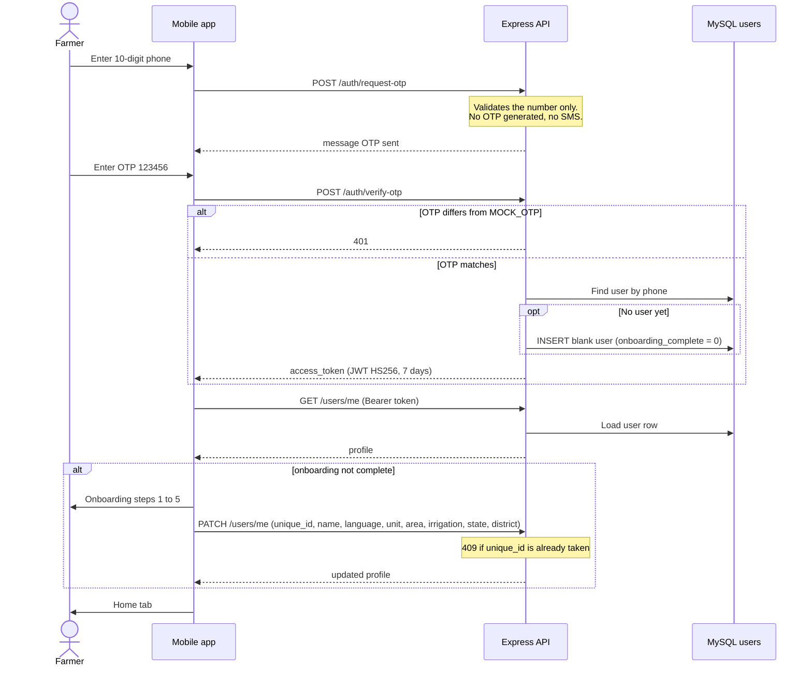
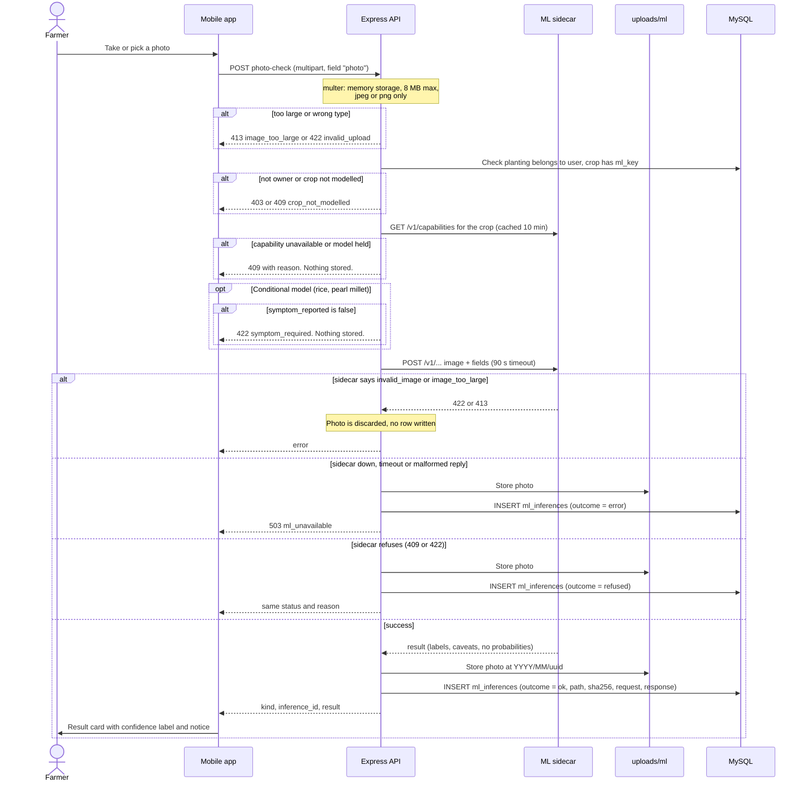
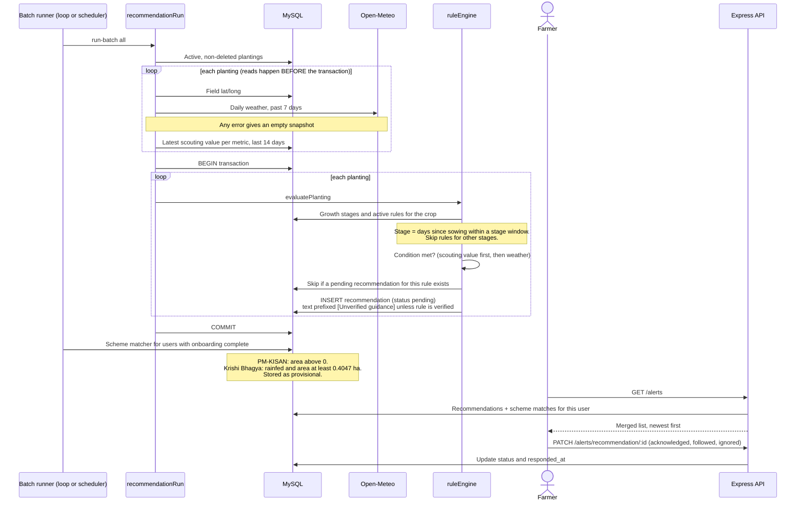
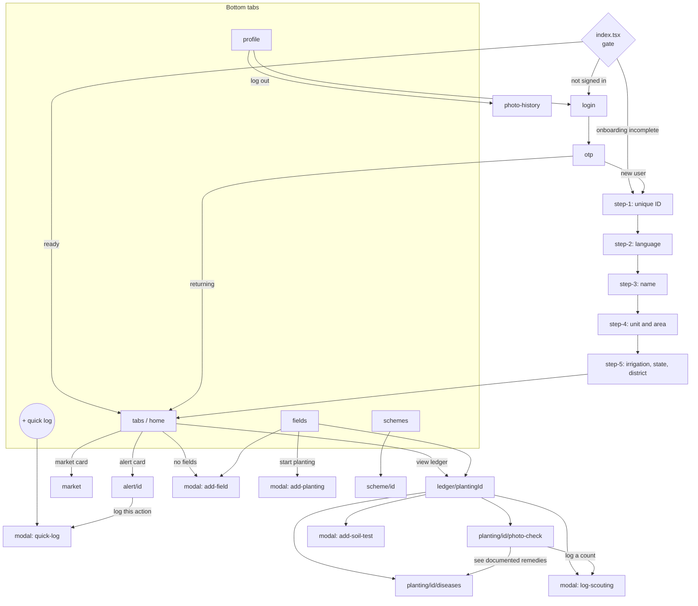

# Architecture and design diagrams

Diagrams are written in [Mermaid](https://mermaid.js.org/), which GitHub, VS Code (with a Mermaid extension) and most Markdown viewers render directly. They describe the code as it is, including known gaps. Sources: `backend/src/routes/`, `backend/src/services/`, `backend/scripts/run-batch.js`, `frontend/sustainable-farming/app/`.

Contents: [1. System architecture](#1-system-architecture) · [2. Data flow](#2-data-flow) · [3. Login and onboarding](#3-sequence-login-and-onboarding) · [4. Photo check](#4-sequence-photo-check) · [5. Alert generation](#5-sequence-alert-generation) · [6. App screen map](#6-app-screen-map)

---

## 1. System architecture

Key points
- The **API** owns authentication, ownership checks, photo storage and the `ml_inferences` audit table.
- The **sidecar** has no database access and listens on localhost only. The API is its only caller. If it is down, ML routes return `503 ml_unavailable` and everything else keeps working.
- **Recommendations and scheme matches** are created by the batch runner (or by `POST /api/v1/internal/*` with `X-Internal-Key`), not per request.
- The app is online-only; there is no offline write queue.

---

## 2. Data flow

ML output is stored only in `ml_inferences`. It never writes `recommendations` (rule-engine output only) or alerts.

---

## 3. Sequence: login and onboarding

Login is a **permanent mock**: no OTP is generated or sent, and any phone number works with the fixed `MOCK_OTP` (default `123456`).

---

## 4. Sequence: photo check

`POST /api/v1/ml/plantings/:id/photo-check` (the soil-type photo at `POST /ml/soil-type` follows the same pattern without the planting and symptom steps).

Deletion: `DELETE /ml/inferences/:id` removes the file and clears `image_path`, but keeps the row and its JSON with `deleted_at` set. See [PRIVACY.md](../PRIVACY.md).

---

## 5. Sequence: alert generation

Rules are drafts with no expert sign-off, which is why advice carries the `[Unverified guidance]` prefix. Pest rules fire only when the farmer has logged scouting counts.

---

## 6. App screen map

Navigation gating happens **only** in `app/index.tsx`. No layout checks session or onboarding state, so a deep link into a tab route would bypass it.

Tabs are Home, Fields, a centre "+" button that opens the quick-log modal (its own `log` tab screen redirects to Home and is effectively unreachable), Schemes and Profile.
