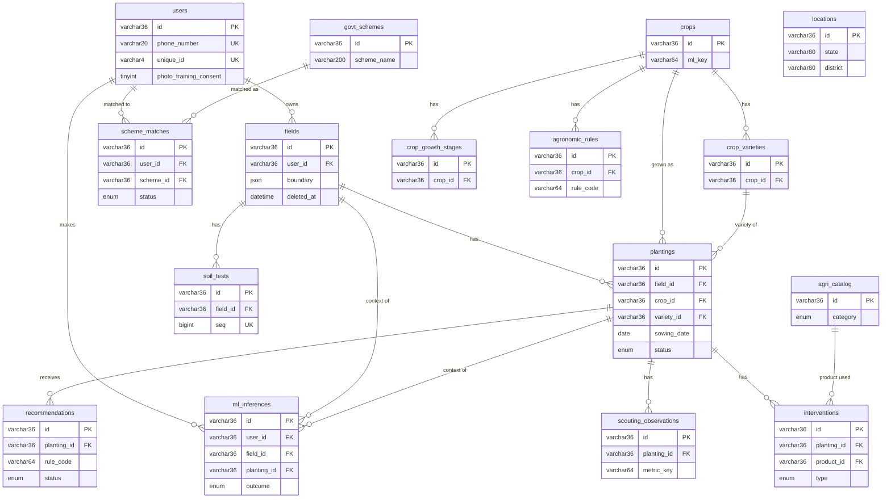

# Database schema

MySQL 8, database `sustainable-farming`, engine InnoDB, charset `utf8mb4` / `utf8mb4_unicode_ci`. The schema is defined by the plain-SQL files in [`backend/migrations/`](../backend/migrations/), applied with `npm run migrate` and tracked in the `schema_migrations` table. This document was written from those files.

Contents: [Conventions](#conventions) · [ER diagram](#er-diagram) · [Tables](#tables) · [Migration history](#migration-history) · [Known quirks](#known-quirks)

## Conventions

- **Primary keys** are UUID strings, `varchar(36)`. The exception is `schema_migrations` (see below).
- **Timestamps** are `datetime`, naive and UTC by project convention (MySQL drops time-zone information).
- **Soft delete**: `fields`, `plantings`, `interventions`, `scouting_observations`, `recommendations`, `scheme_matches` and `ml_inferences` have a nullable `deleted_at`. Rows are flagged, not removed. `users`, `soil_tests` and the reference tables have no `deleted_at`.
- **Enums** hold closed vocabularies (severity, status, category, confidence).
- **JSON columns** hold structured, variable data: `fields.boundary`, `govt_schemes.eligibility_criteria`, `agri_catalog.crop_applicability`, `recommendations.trigger_snapshot`, `ml_inferences.request_json` and `response_json`.
- **Confidence vocabulary**: rules and growth stages use `low` / `medium` / `verified`; scheme matches use `verified` / `provisional`. Nothing in the seed data is expert-verified.

## ER diagram

`locations` is a standalone lookup (state and district names) with no foreign keys. `agronomic_rules` and `crop_growth_stages` link to `crops` only; rules are matched to a planting by crop and growth-stage name, not by foreign key.

## Tables

`PK` primary key, `FK` foreign key, `UK` unique key, `IX` index. "NN" means NOT NULL.

### Farmer data

#### `users`
| Column | Type | Null | Notes |
|---|---|---|---|
| `id` | varchar(36) | NN | PK |
| `phone_number` | varchar(20) | NN | UK. Stored as the last 10 digits. |
| `name` | varchar(120) | NN | Empty string until onboarding |
| `language_pref` | varchar(8) | NN | Default set by the API: `en` |
| `default_unit` | varchar(16) | NN | Land unit, default `hectare` |
| `total_area_hectares` | decimal(12,4) | NN | |
| `irrigation_type` | varchar(32) | NN | Default `rainfed` |
| `state` | varchar(80) | NN | |
| `district` | varchar(80) | NN | |
| `onboarding_complete` | tinyint(1) | NN | Set by the client, not derived by the server |
| `created_at`, `updated_at` | datetime | NN | |
| `unique_id` | varchar(4) | NULL | UK `uq_users_unique_id`. 4-digit farmer ID chosen in onboarding. |
| `photo_training_consent` | tinyint(1) | NN | Default 0. Added in 0003. Recorded only; nothing reads it. |

No database defaults exist for the NOT NULL columns; the API supplies them when it creates the user.

#### `fields`
| Column | Type | Null | Notes |
|---|---|---|---|
| `id` | varchar(36) | NN | PK |
| `user_id` | varchar(36) | NN | FK to `users`, IX |
| `name` | varchar(120) | NN | |
| `area_size_hectares` | decimal(12,4) | NN | |
| `lat`, `long` | decimal(10,7) | NN | Field centre. Used for weather. |
| `boundary` | json | NN | Polygon drawn in the app |
| `soil_type` | varchar(80) | NULL | |
| `created_at`, `updated_at` | datetime | NN | |
| `deleted_at` | datetime | NULL | Soft delete |

#### `soil_tests`
| Column | Type | Null | Notes |
|---|---|---|---|
| `id` | varchar(36) | NN | PK |
| `field_id` | varchar(36) | NN | FK to `fields`, IX |
| `nitrogen`, `phosphorus`, `potassium` | decimal(10,3) | NULL | |
| `ph` | decimal(4,2) | NULL | |
| `ec`, `organic_carbon`, `sulphur`, `zinc`, `iron`, `copper`, `manganese`, `boron` | decimal(10,3) | NULL | Added in 0004. Units as on an Indian soil health card: EC dS/m, organic carbon %, the rest ppm. |
| `tested_at` | datetime | NN | |
| `created_at` | datetime | NN | |
| `seq` | bigint unsigned | NN | AUTO_INCREMENT, UK `uq_soil_tests_seq`. Added in 0005. |

The "latest test" for a field is ordered by `tested_at DESC, seq DESC` (`backend/src/services/soilTests.js`).

#### `plantings`
| Column | Type | Null | Notes |
|---|---|---|---|
| `id` | varchar(36) | NN | PK |
| `field_id` | varchar(36) | NN | FK to `fields`, IX |
| `crop_id` | varchar(36) | NN | FK to `crops`, IX |
| `variety_id` | varchar(36) | NULL | FK to `crop_varieties`, IX |
| `sowing_date` | date | NN | Drives growth-stage lookup |
| `status` | enum('active','harvested') | NN | Batch jobs read only `active` |
| `created_at`, `updated_at` | datetime | NN | |
| `deleted_at` | datetime | NULL | Soft delete |

#### `interventions`
| Column | Type | Null | Notes |
|---|---|---|---|
| `id` | varchar(36) | NN | PK |
| `planting_id` | varchar(36) | NN | FK to `plantings`, IX |
| `type` | enum('chemical','irrigation','labor','harvest') | NN | |
| `product_id` | varchar(36) | NULL | FK to `agri_catalog`, IX |
| `quantity_metric` | decimal(14,4) | NULL | |
| `quantity_unit` | varchar(24) | NULL | Free text. Never converted. |
| `cost_in_inr` | decimal(14,2) | NN | |
| `intervention_date` | date | NN | |
| `notes` | text | NULL | |
| `created_at`, `updated_at` | datetime | NN | |
| `deleted_at` | datetime | NULL | Soft delete |

#### `scouting_observations`
| Column | Type | Null | Notes |
|---|---|---|---|
| `id` | varchar(36) | NN | PK |
| `planting_id` | varchar(36) | NN | FK to `plantings`, IX |
| `metric_key` | varchar(64) | NN | Matches a rule's `condition_field` |
| `metric_value` | decimal(10,4) | NN | |
| `observed_at` | date | NN | |
| `notes` | text | NULL | |
| `created_at`, `updated_at` | datetime | NN | |
| `deleted_at` | datetime | NULL | Soft delete |

### Generated output

#### `recommendations` (rule-engine output only)
| Column | Type | Null | Notes |
|---|---|---|---|
| `id` | varchar(36) | NN | PK |
| `planting_id` | varchar(36) | NN | FK to `plantings`, IX |
| `rule_code` | varchar(64) | NN | |
| `trigger_snapshot` | json | NN | Stage, condition field, observed and threshold values |
| `recommendation_text` | text | NN | Prefixed `[Unverified guidance]` unless the rule is `verified` |
| `severity` | enum('info','advisory','critical') | NN | |
| `status` | enum('pending','acknowledged','followed','ignored') | NN | No DB default; the code writes `pending` |
| `farmer_feedback_note` | text | NULL | |
| `generated_at` | datetime | NN | |
| `responded_at` | datetime | NULL | |
| `created_at`, `updated_at` | datetime | NN | |
| `deleted_at` | datetime | NULL | |
| `confidence` | enum('low','medium','verified') | NN | Copied from the rule |

#### `scheme_matches`
| Column | Type | Null | Notes |
|---|---|---|---|
| `id` | varchar(36) | NN | PK |
| `user_id` | varchar(36) | NN | FK to `users`, IX |
| `scheme_id` | varchar(36) | NN | FK to `govt_schemes`, IX |
| `matched_at` | datetime | NN | |
| `status` | enum('matched','viewed','dismissed','claimed') | NN | |
| `match_confidence` | enum('verified','provisional') | NN | The matcher writes `provisional` |
| `created_at`, `updated_at` | datetime | NN | |
| `deleted_at` | datetime | NULL | |

#### `ml_inferences` (added in 0003)
One row per model call made on a farmer's behalf. ML output lives here and never in `recommendations`.

| Column | Type | Null | Notes |
|---|---|---|---|
| `id` | varchar(36) | NN | PK |
| `user_id` | varchar(36) | NN | FK to `users`. IX `ix_ml_inferences_user_created (user_id, created_at)` |
| `field_id` | varchar(36) | NULL | FK to `fields` |
| `planting_id` | varchar(36) | NULL | FK to `plantings`, IX |
| `model` | varchar(64) | NN | e.g. `soil_type_photo` |
| `crop_key` | varchar(64) | NULL | Matches `crops.ml_key` |
| `image_path` | varchar(255) | NULL | Relative path under `backend/uploads/`. Cleared on delete. |
| `image_sha256` | char(64) | NULL | |
| `request_json`, `response_json` | json | NULL | Kept even after the photo is deleted |
| `outcome` | enum('ok','refused','error') | NN | |
| `created_at` | datetime | NN | |
| `deleted_at` | datetime | NULL | |

### Reference data (seeded by `npm run seed`)

#### `crops`
`id` PK, `name` varchar(120) NN, `ml_key` varchar(64) NULL (added in 0003; the crop's key in the ML layer), `active` tinyint(1) NN, `created_at`, `updated_at`. Migration 0003 sets `ml_key` for Rice, Ragi (Finger Millet), Maize, Cotton and Sugarcane; later crops get theirs from the seed data.

#### `crop_varieties`
`id` PK, `crop_id` FK to `crops` (IX), `name` varchar(120) NN, `created_at`, `updated_at`.

#### `crop_growth_stages`
`id` PK, `crop_id` FK (IX), `stage_name` varchar(80), `stage_order` int, `typical_days_from_sowing_start` int, `typical_days_from_sowing_end` int, `confidence` enum('low','medium','verified'), `source` text, `created_at`, `updated_at` (all NN). A planting is in a stage when `start <= days since sowing < end`.

#### `agronomic_rules`
`id` PK, `rule_code` varchar(64) (IX), `crop_id` FK (IX), `stage_name` varchar(80), `condition_field` varchar(64) NULL, `operator` varchar(8) NULL, `threshold_value` decimal(14,4) NULL, `severity` enum('info','advisory','critical'), `recommendation_text` text, `confidence` enum('low','medium','verified'), `source` text, `active`, `created_at`, `updated_at`. A rule with no `condition_field` is treated as always met for its stage.

#### `agri_catalog`
`id` PK, `category` enum('seed','fertilizer','pesticide','herbicide','fungicide','biocontrol'), `name` varchar(160), `crop_applicability` json NULL, `unit_of_measure` varchar(24), `typical_dosage_per_hectare` decimal(14,4) NULL, `active`, `created_at`, `updated_at`. Product names and dosages shown to farmers come from here, never from a model.

#### `govt_schemes`
`id` PK, `scheme_name` varchar(200), `authority` varchar(160), `eligibility_criteria` json, `benefit_description` text, `application_url` varchar(500) NULL, `active`, `created_at`, `updated_at`. The matcher looks schemes up by exact `scheme_name`.

#### `locations`
`id` PK, `state` varchar(80), `district` varchar(80), `active`, `created_at`, `updated_at`. UK `uq_locations_state_district (state, district)`, IX on `state`.

### Migration bookkeeping

#### `schema_migrations`
Created by `backend/src/migrate.js`, not by a migration file: `version` varchar(64) PK, `applied_at` datetime NN, `stamped` tinyint(1) NN default 0.

## Migration history

| File | What it changed |
|---|---|
| `0001_baseline.sql` | Creates the 14 original tables: `users`, `locations`, `govt_schemes`, `crops`, `crop_varieties`, `agri_catalog`, `crop_growth_stages`, `agronomic_rules`, `fields`, `plantings`, `interventions`, `scouting_observations`, `recommendations`, `scheme_matches`. It is the schema as of the last Alembic revision `e1f2a3b4c5d6`, captured with `SHOW CREATE TABLE`. |
| `0002_soil_tests.sql` | Creates `soil_tests` (N, P, K, pH) so crop recommendation can use a farmer's own values instead of generic defaults. |
| `0003_ml_serving.sql` | Adds `crops.ml_key` and sets it for five crops; adds `users.photo_training_consent`; creates `ml_inferences`. |
| `0004_soil_test_card.sql` | Adds eight soil-card columns to `soil_tests` (EC, organic carbon, sulphur, zinc, iron, copper, manganese, boron) for the 12-value soil-fertility model. |
| `0005_soil_test_order.sql` | Adds `soil_tests.seq` (auto-increment, unique) so tests saved in the same second keep insertion order. |

**Applying migrations**
- Empty database: every file runs.
- Database built by the old Alembic tooling (revision `e1f2a3b4c5d6`): the baseline is stamped as applied without running any DDL, and later files run normally. The `alembic_version` table is left alone.
- Any other existing state is refused rather than guessed at.
- Schema changes from here on are new numbered `.sql` files.

## Known quirks

- `recommendations.status` and most NOT NULL columns have no database default; the application supplies the values.
- `fields.long` is a column named `long`, which is a MySQL keyword. Queries must quote it with backticks.
- Soft-deleting a field or planting does not cascade. Its soil tests, interventions, observations, recommendations and `ml_inferences` remain, and several queries do not check whether the parent is deleted. `GET /alerts` does not filter out soft-deleted plantings or fields, and the batch job reads a planting's field without a `deleted_at` filter.
- `ml_inferences` rows are never purged. Deleting a photo clears `image_path` but keeps `request_json` and `response_json`.
- `interventions.quantity_unit` is free text and is never converted.
- `users` has no `deleted_at`, and there is no account-deletion path.
